<div align="center">

# House Muse

### AI-assisted interior design: upload a room, choose a style and budget, get a redesigned visualization and a priced décor plan.

[](https://react.dev/)
[](https://www.typescriptlang.org/)
[](https://vite.dev/)
[](https://tailwindcss.com/)
[](https://www.djangoproject.com/)
[](https://www.django-rest-framework.org/)
[](https://flask.palletsprojects.com/)
[](https://www.postgresql.org/)
[](https://opencv.org/)
[](https://docs.ultralytics.com/)
[](https://huggingface.co/docs/diffusers/)
[](https://huggingface.co/spaces)

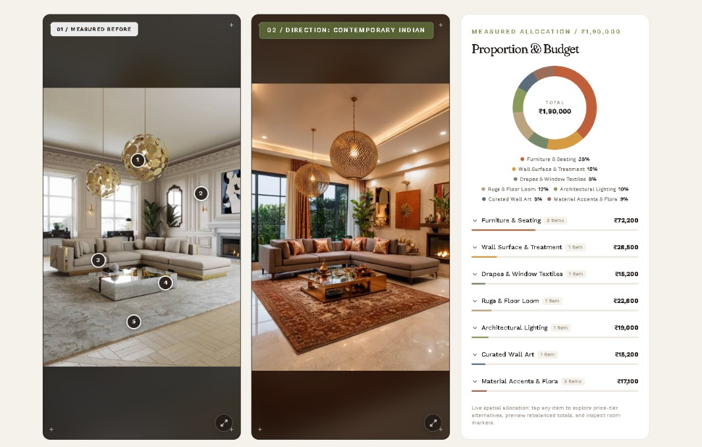

<sub>Results view from the House Muse web app: measured "before" photo with item markers, the generated Contemporary Indian redesign, and the catalogue-backed budget breakdown.</sub>

</div>

---

## Table of contents

1. [Overview](#overview)
2. [Product showcase](#product-showcase)
3. [Problem and motivation](#problem-and-motivation)
4. [Implementation status at a glance](#implementation-status-at-a-glance)
5. [Key features](#key-features)
6. [AI/ML architecture](#aiml-architecture)
7. [Generative AI pipeline](#generative-ai-pipeline)
8. [System architecture](#system-architecture)
9. [End-to-end workflow](#end-to-end-workflow)
10. [Technology stack](#technology-stack)
11. [Project structure](#project-structure)
12. [Installation and setup](#installation-and-setup)
13. [Environment configuration](#environment-configuration)
14. [API reference](#api-reference)
15. [Database and authentication](#database-and-authentication)
16. [Model evaluation](#model-evaluation)
17. [Performance benchmarking](#performance-benchmarking)
18. [Testing and validation](#testing-and-validation)
19. [Engineering decisions and trade-offs](#engineering-decisions-and-trade-offs)
20. [Limitations](#limitations)
21. [Future improvements](#future-improvements)
22. [Contributing](#contributing)
23. [License](#license)
24. [Project information](#project-information)

---

## Overview

House Muse takes a photograph of a room plus a few inputs (room type, dimensions, one of nine design styles, a budget in INR) and returns two things:

1. **A redesigned visualization** of that room in the chosen style, generated by a remote Stable Diffusion XL pipeline that uses a depth map of the original photo as structural guidance.
2. **A priced décor plan** built from a 378-row catalogue of paints, wallpapers and furniture/décor items, with a category-level budget breakdown and price-tier alternatives.

The system is split into three independently run services:

- a **React + TypeScript** single-page app,
- a **Django REST Framework** API that owns authentication, saved projects and the catalogue,
- a **Flask** service that runs computer vision (YOLOv8 object detection, K-Means colour extraction, lighting analysis), palette and recommendation logic, and brokers image generation to a **Hugging Face Space** running SDXL + depth ControlNet + style LoRAs.

The browser only ever talks to Django. Django calls Flask server-to-server, and Flask calls the hosted generation service.

> **A note on scope.** House Muse is a project-scale system run in local development. The generation pipeline depends on an external Hugging Face Space, the evaluation sets are small (nine generated images), and there is no production deployment or load testing. Every quantitative result below is labelled with its source and limits. See [Implementation status](#implementation-status-at-a-glance) and [Limitations](#limitations).

---

## Product showcase

### Guided studio workflow

The Studio is a four-step wizard: upload, room details, style, budget.

| Step 1: Upload | Step 2: Room details | Step 4: Budget |
|:---:|:---:|:---:|
| 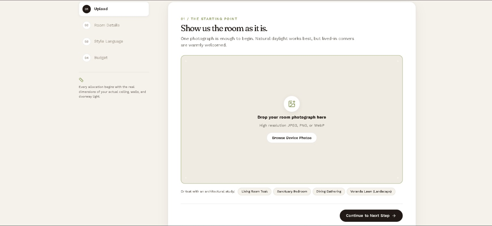 | 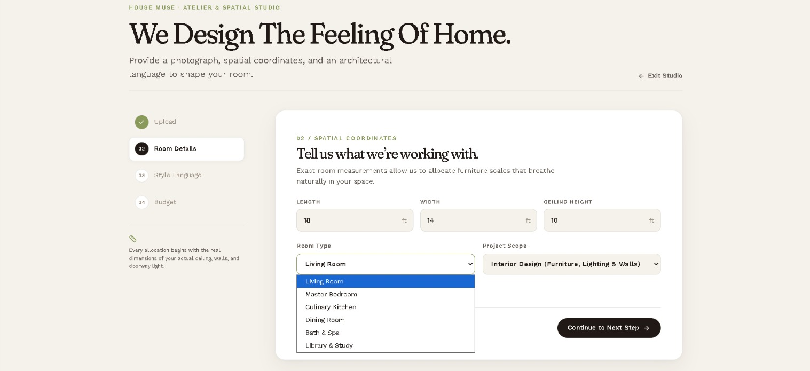 | 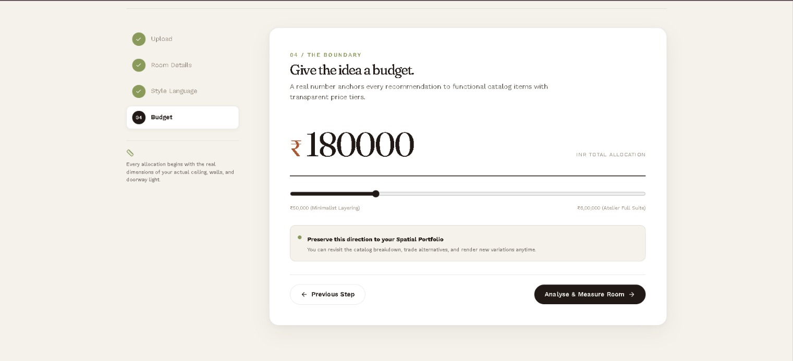 |
| Photo upload, with built-in sample rooms to try. | Dimensions in feet, six room types, three project scopes. | Total INR allocation that anchors catalogue recommendations. |

*Screenshots cropped from the project report. The style-selection step (step 3) is not shown here.*

### Generated redesigns with budget breakdown

The results view pairs the original photo (with numbered item markers) with the generated redesign and a live category breakdown. Each line item can be expanded to compare price-tier alternatives.

<p align="center">
  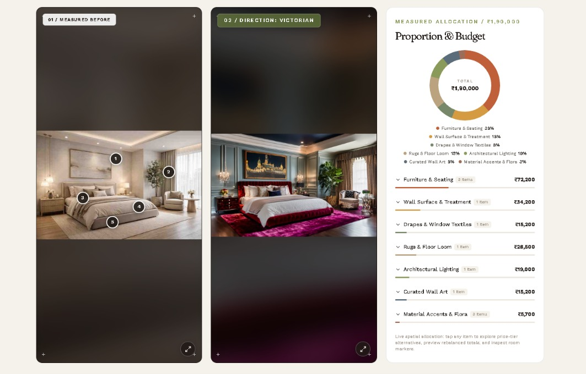
  <br>
  <sub>Bedroom redesigned in the Victorian style, with a seven-category budget breakdown (total ₹1,90,000 in this run).</sub>
</p>

### One pipeline, nine styles

<p align="center">
  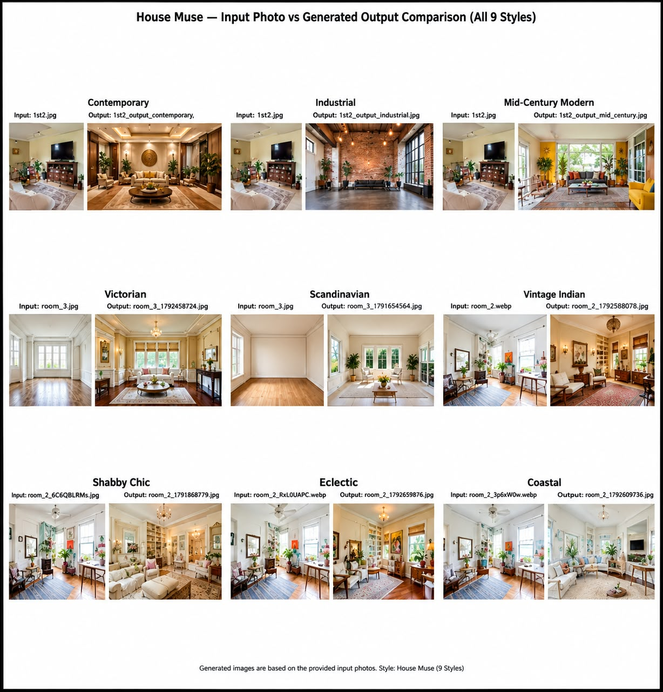
  <br>
  <sub>Input photo versus generated output for each of the nine supported styles. Different styles were run on different source photos, so this figure shows range of output, not a single-room style comparison. Taken from the project report's qualitative evaluation.</sub>
</p>

### Computer vision and evaluation visuals

Detector comparison, CLIP style-alignment and structural-preservation charts are in [Model evaluation](#model-evaluation).

---

## Problem and motivation

Visualizing a redesign normally means a designer's time, or generic mood boards that ignore the room you actually have. Text-to-image tools can produce attractive rooms, but those rooms are not *your* room: walls, windows and proportions change from one generation to the next, and the output comes with no cost or product information.

House Muse explores combining three things in one workflow:

- **Image understanding** (what is in the room, what colours and lighting it has) so the request is grounded in the uploaded photo.
- **Depth-conditioned generation** so the redesign is guided by the photo's geometry rather than starting from text alone.
- **A structured catalogue and budget** so the result is not only an image but something a user can price and act on.

How well the generation preserves geometry is measured, not assumed. See [Model evaluation](#model-evaluation) for the results and their limits.

---

## Implementation status at a glance

This table separates what is wired into the running application from what is optional, report-only, or absent. It was produced by auditing the source in this repository.

| Component | Status | Notes |
|---|---|---|
| React/TypeScript Studio, Dashboard, Auth | **Implemented** | Routes: `/`, `/studio`, `/dashboard`, `/auth`, `/reset-password/:uid/:token` |
| Django REST API with Knox auth, user-scoped projects | **Implemented** | Covered by 5 passing Django tests |
| Flask analysis service (`/api/analyse`, `/api/palette`) | **Implemented** | Space analysis, colour palette, recommendations |
| YOLOv8 object detection | **Implemented** | Uses fine-tuned weights if present at `YOLO_WEIGHTS`, otherwise falls back to pretrained COCO `yolov8m.pt` |
| K-Means dominant and per-object colour extraction | **Implemented** | scikit-learn `KMeans` |
| Lighting detection, room-type handling | **Implemented** | Lighting: bright/dim plus warm/cool/neutral colour temperature. The user-supplied room type always takes priority (the Studio always sends one); Places365, CLIP and object voting run only when no room type is provided |
| SAM masks, CLIP features, Places365 | **Optional** | Loaded only if the packages and checkpoints are installed; the code degrades gracefully without them. Not in `ml/requirements.txt` |
| SDXL + depth ControlNet + 9 style LoRAs (Hugging Face Space) | **Implemented, remote** | Code for the Space is in `ml/hf_space/`. LoRA weight files are not in the repository |
| Depth estimation (Depth-Anything-small) | **Implemented, inside the Space** | Produces the ControlNet depth map |
| Iterative refinement (SDXL ControlNet img2img) | **Implemented** | Default strength 0.35; history stored per project |
| BLIP captioning | **Implemented, optional at runtime** | Via Hugging Face Inference API when `HF_API_TOKEN` is set; otherwise a structured prompt fallback is used |
| Fallback generators (Pollinations.AI text-to-image, Stability AI) | **Implemented as fallbacks** | These do **not** use the room photo for structure; see [Generative AI pipeline](#generative-ai-pipeline) |
| YOLO training and evaluation scripts | **Present** | `ml/training/`, `ml/evaluate_yolo.py`. Trained weights and metrics are not in the repository |
| YOLO-World v2 | **Report experiment only** | Not used by the application code |
| Performance instrumentation and benchmark harness | **Not in this repository** | Described in the benchmark report; see [Performance benchmarking](#performance-benchmarking) |
| Production deployment, load testing | **Not done** | |

---

## Key features

- **Guided room redesign.** Photo upload, dimensions, six room types (living room, bedroom, kitchen, dining room, bathroom, study room), three project scopes (home décor, interior design, full transformation), and nine styles: Coastal, Industrial, Contemporary Indian, Vintage Indian, Scandinavian, Eclectic, Shabby Chic, Mid-Century Modern, Victorian.
- **Room analysis.** Object detection, dominant-colour palette, lighting condition, room-size and ceiling classification, and style similarity scores for uploaded photos.
- **Palette generation.** Analogous, complementary and triadic palettes derived from extracted colours, with style-driven wall, accent and ceiling colours.
- **Depth-guided style transfer.** SDXL with a depth ControlNet and a per-style LoRA adapter, hosted as a Hugging Face Space.
- **Iterative refinement.** Natural-language edit requests (for example "warm up the lighting") applied as img2img on the latest generated image, with an ordered per-project history.
- **Catalogue-backed budget breakdown.** 378 catalogue rows across 12 categories and three price tiers; the UI shows seven budget categories with a donut chart and tier alternatives.
- **Accounts and saved projects.** Email/password and Google Sign-In, Knox token authentication, password reset, and projects visible only to their owner.

---

## AI/ML architecture

All analysis runs in the Flask service (`ml/`). The main entry point is `process_image()` in `ml/modules/image_processor.py`.

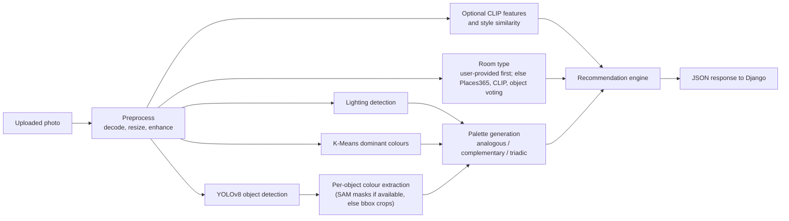

| Stage | What it does | Implementation |
|---|---|---|
| Preprocessing | Decodes and normalises the photo for analysis | `preprocess_image` |
| Lighting | Bright/dim from mean grey level; warm/cool/neutral from the red-to-blue ratio | `detect_lighting` |
| Object detection | Detects furniture and décor objects | Ultralytics YOLOv8; fine-tuned weights via `YOLO_WEIGHTS`, else COCO `yolov8m.pt` |
| Colour extraction | Dominant colours for the whole image and per detected object | scikit-learn `KMeans`; SAM masks when available, bounding-box crops otherwise |
| Room type | Uses the user-supplied room type when present; otherwise tries Places365, then CLIP zero-shot, then object voting, then a default | `infer_room_type` |
| Space analysis | Room area, volume, size and ceiling class, layout and lighting tips from L × W × H | `modules/space_analyzer.py` |
| Palette | Style-driven wall/accent/ceiling colours plus harmony schemes | `modules/color_palette.py`, `get_style_palette` |
| Recommendations | Scores catalogue items against style, budget, colours and (optionally) image features | `modules/recommendation_engine.py` |

**On the object detector.** `ml/training/` contains a dataset builder and a YOLOv8m fine-tuning script (IKEA product images plus ADE20K indoor scenes), and `ml/evaluate_yolo.py` computes precision/recall/mAP. The trained weights and their evaluation outputs are **not** in this repository, and `.gitignore` excludes `*.pt`. Without a weights file, the service runs pretrained COCO YOLOv8m. No custom-detector accuracy is claimed in this README.

---

## Generative AI pipeline

Image generation runs on a Hugging Face Space (`ml/hf_space/app.py`, Gradio + ZeroGPU). The Flask service calls it through `gradio_client`.

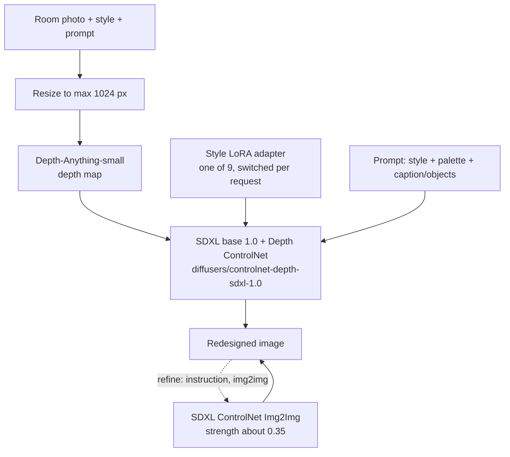

**Components** (from `ml/hf_space/app.py`):

| Part | Detail |
|---|---|
| Base model | `stabilityai/stable-diffusion-xl-base-1.0` with the `madebyollin/sdxl-vae-fp16-fix` VAE |
| Structural guidance | Depth map from `LiheYoung/depth-anything-small-hf`, fed to `diffusers/controlnet-depth-sdxl-1.0` |
| Style conditioning | Nine LoRA adapters (Coastal, Contemporary Indian, Eclectic, Industrial, Mid-Century, Scandinavian, Shabby Chic, Victorian, Vintage Indian), pre-loaded and switched with `set_adapters` |
| Defaults | ControlNet scale 0.45, LoRA scale 0.80, 30 inference steps, guidance 7.5, refine strength 0.35 |
| Endpoints | Gradio API names `/redesign` and `/refine` |
| Hardware | Configured for Hugging Face ZeroGPU |

**Prompt construction.** When `HF_API_TOKEN` is set, the Flask service captions the uploaded photo with BLIP (`Salesforce/blip-image-captioning-large`, via the Inference API) and builds an SDXL prompt from the caption, style, palette colours, room type and detected objects. Without a token it uses a structured fallback prompt.

**Provider fallback chain** (`ml/modules/image_generator.py`):

1. Hugging Face Space (SDXL + depth ControlNet + LoRA), only when a room image is supplied **and** `HF_SPACE_ID` is set.
2. Pollinations.AI (text-to-image, no key).
3. Stability AI, only when `STABILITY_API_KEY` is set.

> **Important.** Steps 2 and 3 are text-to-image fallbacks that do not use the room photo as structural input, so they do not preserve the original room's geometry. Geometry guidance exists only on the Hugging Face Space path. The Space also depends on LoRA weight files that are not distributed with this repository.

**What has and has not been validated.** The pipeline is implemented and produced the outputs shown in the [showcase](#one-pipeline-nine-styles) and evaluated in [Model evaluation](#model-evaluation). House Muse does not claim guaranteed preservation of room geometry: the measured structural similarity is moderate and varies by style. A baseline-versus-ControlNet comparison has not been run.

---

## System architecture

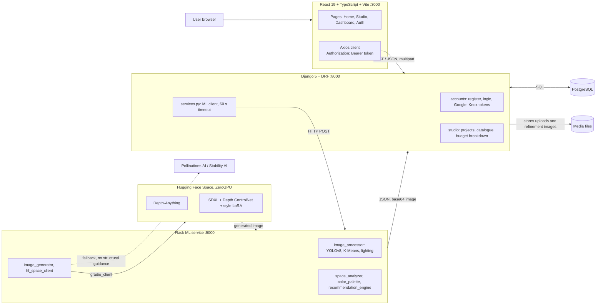

**Responsibilities**

| Service | Owns | Does not do |
|---|---|---|
| **Frontend** | UI state, wizard flow, token storage, request/response handling | Never calls Flask or the Space directly |
| **Django** | Authentication and authorization, project persistence, catalogue tables, budget breakdown, media storage, calls to Flask | No ML inference |
| **Flask** | Computer vision, palette and recommendation logic, prompt building, generation orchestration | No database access, no authentication; it is a compute service called server-to-server |
| **Hugging Face Space** | GPU diffusion inference | Everything else |

---

## End-to-end workflow

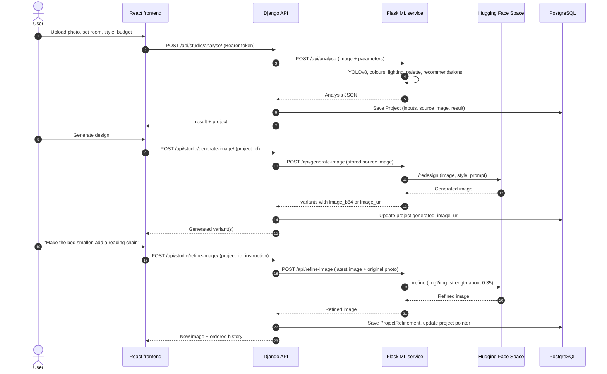

Failure handling: if Flask is unreachable or errors, Django returns **502** with a message (`MLServiceError`). If a project has no earlier generated image, refinement returns **400**. If generation fails on the Space path, the Flask service falls back as described in the [generation pipeline](#generative-ai-pipeline).

---

## Technology stack

| Layer | Technologies (verified against dependency files) |
|---|---|
| **Frontend** | React 19, TypeScript 5.6, Vite 7, Tailwind CSS 4 (`@tailwindcss/vite`), wouter (routing), Axios, lucide-react, Radix UI Slot, class-variance-authority, tailwind-merge |
| **Backend** | Django 5.0.6, Django REST Framework 3.15.1, django-rest-knox 5.0.2, django-cors-headers 4.3.1, google-auth 2.29.0, psycopg 3 (binary), python-dotenv, Pillow, requests |
| **ML service** | Flask 2.3.3, flask-cors, Werkzeug, python-dotenv, requests, gradio_client, pydantic |
| **Computer vision** | OpenCV (`opencv-python-headless`), Ultralytics YOLOv8, colormath, albumentations (training), scikit-learn (K-Means, cosine similarity; see setup note) |
| **Machine learning** | PyTorch and torchvision (installed as Ultralytics dependencies), optional SAM, CLIP and Places365 |
| **Generative AI (Space)** | diffusers, transformers, accelerate, peft, safetensors; SDXL 1.0, SDXL depth ControlNet, Depth-Anything-small, nine LoRA adapters; Gradio on ZeroGPU |
| **Database** | PostgreSQL (application); in-memory SQLite for the Django test suite |
| **Tooling** | Vite build, `tsc --noEmit`, Django test runner, Python `unittest` |

---

## Project structure

The repository root contains one project folder, `house-muse/`. Abridged tree of the tracked source:

```text
.
├── README.md
├──Images/   # figures used in this README                 
└── house-muse/
    ├── backend/                    # Django REST API
    │   ├── manage.py
    │   ├── requirements.txt
    │   ├── .env.example
    │   ├── config/                 # settings.py, urls.py, test_settings.py, wsgi.py
    │   ├── accounts/               # users, Knox auth, Google sign-in, password reset
    │   ├── studio/                 # projects, refinements, catalogue, ML service client
    │   │   ├── models.py  views.py  serializers.py  services.py  tests.py
    │   │   └── management/commands/load_catalog.py
    │   └── data/catalog_seed.csv   # 378-row catalogue
    ├── frontend/                   # React + TypeScript (Vite)
    │   ├── package.json  vite.config.ts  .env.example
    │   ├── public/images/          # landing-page room images
    │   └── src/
    │       ├── App.tsx  main.tsx
    │       ├── lib/api.ts          # Axios client and typed API helpers
    │       ├── components/ui/      # button, card
    │       └── pages/              # Home, Studio, Dashboard, Auth, NotFound
    └── ml/                         # Flask ML service
        ├── app.py                  # endpoints
        ├── requirements.txt
        ├── modules/                # image_processor, color_palette, space_analyzer,
        │                           # recommendation_engine, caption_engine, catalog_loader,
        │                           # image_generator, hf_space_client, controlnet_generator
        ├── hf_space/               # Hugging Face Space app (SDXL + ControlNet + LoRA)
        ├── training/               # YOLO dataset builder and training script
        ├── evaluate_yolo.py
        ├── test_refine_api.py  test_hf_space.py
        ├── data/catalog_seed.csv
        └── test_outputs/           # sample before/after generations
```

---

## Installation and setup

**Prerequisites:** Git, Python 3.10+, Node.js 20.19+ (required by Vite 7), PostgreSQL. A Hugging Face Space running `ml/hf_space/` is needed for geometry-guided generation (see [Environment configuration](#environment-configuration)); analysis, authentication and project management work without it.

The three services run in separate terminals, started in this order. Commands below use macOS/Linux syntax. On Windows, activate environments with `venv\Scripts\activate` and use `copy` instead of `cp`.

```bash
git clone https://github.com/ArnavGit17/House-Muse.git
cd House-Muse/house-muse
```

### 1. Database

Create a PostgreSQL database and user that match the values you put in `backend/.env`:

```bash
createdb house_muse            # or create it in psql / pgAdmin
```

### 2. Django backend (port 8000)

```bash
cd backend
python -m venv venv
source venv/bin/activate
pip install -r requirements.txt
cp .env.example .env           # then edit .env (see Environment configuration)
python manage.py migrate
python manage.py load_catalog data/catalog_seed.csv
python manage.py runserver
```

`load_catalog` populates the `WallOption` and `DecorItem` tables that the budget breakdown reads. Without it the breakdown has no catalogue rows to sum.

### 3. Flask ML service (port 5000)

```bash
cd ml
python -m venv venv
source venv/bin/activate
pip install -r requirements.txt
pip install scikit-learn       # imported by the code but not listed in requirements.txt
python app.py
```

On first run, Ultralytics downloads `yolov8m.pt` if no fine-tuned weights are configured. SAM, CLIP and Places365 are optional and not installed by `requirements.txt`.

### 4. React frontend (port 3000)

```bash
cd frontend
npm install
cp .env.example .env.local     # then edit .env.local
npm run dev
```

Open `http://localhost:3000`.

---

## Environment configuration

Never commit real values. Use placeholders like the ones below and keep `.env` files out of version control.

### Backend: `backend/.env`

| Variable | Purpose | Example placeholder |
|---|---|---|
| `DJANGO_SECRET_KEY` | Django secret key | `change-me-to-a-long-random-string` |
| `DJANGO_DEBUG` | `True` for local development | `True` |
| `DJANGO_ALLOWED_HOSTS` | Comma-separated hosts | `localhost,127.0.0.1` |
| `DB_NAME`, `DB_USER`, `DB_PASSWORD`, `DB_HOST`, `DB_PORT` | PostgreSQL connection | `house_muse`, `<user>`, `<password>`, `localhost`, `5432` |
| `CORS_ALLOWED_ORIGINS` | Allowed frontend origins | `http://localhost:3000` |
| `FRONTEND_URL` | Used in password-reset links | `http://localhost:3000` |
| `GOOGLE_OAUTH_CLIENT_ID` | Verifies Google ID tokens (optional) | `<google-oauth-client-id>` |
| `ML_SERVICE_URL` | Where the Flask service runs | `http://localhost:5000` |
| `EMAIL_BACKEND` | Defaults to the console backend in development | (optional) |

### ML service: environment variables

The Flask app calls `load_dotenv()`, so these can go in a `.env` file in the directory you start it from (`ml/`).

| Variable | Purpose | Required? |
|---|---|---|
| `HF_SPACE_ID` | Your Hugging Face Space, as `<username>/<space-name>` | Required for depth-guided generation |
| `HF_API_TOKEN` (or `HF_TOKEN`) | Hugging Face token for the Space and BLIP captioning | Recommended |
| `STABILITY_API_KEY` | Enables the Stability AI fallback | Optional |
| `YOLO_WEIGHTS` | Path to fine-tuned YOLO weights | Optional (defaults to COCO `yolov8m.pt`) |
| `SAM_CHECKPOINT` | Path to a SAM checkpoint | Optional |
| `PORT` | Flask port | Optional (default 5000) |

### Hugging Face Space

| Variable | Purpose |
|---|---|
| `HF_LORA_REPO` | Hub repository to download the nine `.safetensors` LoRA files from, if they are not bundled in the Space under `models/loras/` |

### Frontend: `frontend/.env.local`

| Variable | Purpose | Example placeholder |
|---|---|---|
| `VITE_API_BASE` | Django API base URL | `http://localhost:8000/api` |
| `VITE_GOOGLE_CLIENT_ID` | Google Sign-In client ID; leave unset to hide the button | `<google-oauth-client-id>` |

The frontend source reads `VITE_GOOGLE_CLIENT_ID`. Use that exact name; Vite exposes only variables prefixed with `VITE_`.

---

## API reference

All Django endpoints are under `/api/`. Protected endpoints expect `Authorization: Bearer <token>` (the Knox header prefix is configured as `Bearer`). The default DRF permission is `IsAuthenticated`; the auth endpoints marked "No" override it.

### Django REST API (`:8000`)

| Method | Endpoint | Purpose | Auth |
|---|---|---|---|
| POST | `/api/auth/register/` | Create a user and return `{user, token}` (201) | No |
| POST | `/api/auth/login/` | Username and password; returns `{user, token}`, 401 on bad credentials | No |
| POST | `/api/auth/google/` | Exchange a Google `id_token` for `{user, token}` | No |
| POST | `/api/auth/logout/` | Invalidate the current token | Yes |
| POST | `/api/auth/logout-all/` | Invalidate all of the user's tokens | Yes |
| GET | `/api/auth/me/` | Current user | Yes |
| POST | `/api/auth/password-reset/` | Request a reset email (`email`) | No |
| POST | `/api/auth/password-reset/confirm/` | Confirm reset (`uid`, `token`, `new_password`) | No |
| POST | `/api/studio/analyse/` | Multipart: `room_type`, `length`, `width`, `height`, `styles`, `budget`, `scope`, `num_rooms`, `harmony`, `save`, optional `image`. Forwards to Flask, optionally saves a `Project`. Returns `{result, project}`; 502 if the ML service fails | Yes |
| POST | `/api/studio/generate-image/` | Generate a redesign, optionally for a `project_id` | Yes |
| POST | `/api/studio/refine-image/` | `{project_id, instruction}`; returns the refined image and ordered refinement history; 400 if no prior image, 404 if the project is not the caller's | Yes |
| GET, POST | `/api/studio/projects/` | List the caller's projects / create one | Yes |
| GET, PUT, PATCH, DELETE | `/api/studio/projects/{id}/` | Retrieve, update, delete one of the caller's projects | Yes |

Example login:

```bash
curl -X POST http://localhost:8000/api/auth/login/ \
  -H "Content-Type: application/json" \
  -d '{"username": "<username>", "password": "<password>"}'
# → {"user": {...}, "token": "<knox-token>"}
```

### Flask ML service (`:5000`, internal)

These endpoints have no authentication and are intended to be called only by Django. Do not expose them publicly.

| Method | Endpoint | Purpose |
|---|---|---|
| GET | `/api/health` | Health check; returns `{"status": "ok", ...}` |
| POST | `/api/analyse` | Room analysis: space metrics, palette, detections, recommendations (multipart form with optional `image`) |
| POST | `/api/palette` | Palette from room type, dimensions, styles and harmony (JSON) |
| POST | `/api/generate-image` | Prompt building and image generation; 1 to 3 variants (JSON or multipart) |
| POST | `/api/refine-image` | img2img refinement from an init image plus an instruction; 400 if either is missing |

Flask limits uploads to 25 MB. Django waits up to 60 seconds for the ML service.

---

## Database and authentication

### Data model

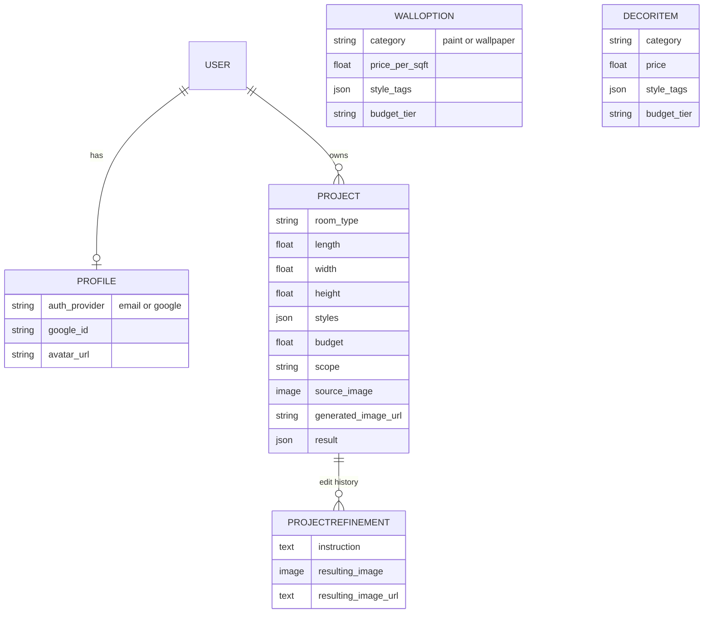

The catalogue tables (`WallOption`, `DecorItem`) are standalone reference data loaded from CSV, not linked to users. Catalogue data uses `budget`, `mid` and `premium` tiers; the Studio UI presents them as Essential, Atelier and Heritage.

### Authentication flow

1. **Register or log in** (`/api/auth/register/`, `/login/`) or **Google Sign-In** (`/api/auth/google/`). For Google, the backend verifies the ID token with `google-auth` against `GOOGLE_OAUTH_CLIENT_ID`.
2. Django issues a **Knox token** (`AuthToken.objects.create`). Knox stores only a hash of the token server-side. Tokens live for **14 days**, and multiple devices are allowed (`TOKEN_LIMIT_PER_USER = None`).
3. The Axios client reads the token from `localStorage` and sends `Authorization: Bearer <token>` on every request.
4. `logout` invalidates the current token; `logout-all` invalidates all of the user's tokens.

### Security practices in the code

- Authentication is required by default (`IsAuthenticated`); only auth endpoints are open.
- Project access is **user-scoped**: `ProjectViewSet.get_queryset` filters by `owner=request.user`, and generate/refine look projects up by `id` **and** `owner`, so one user cannot reach another's project.
- Passwords go through Django's validators (similarity, length, common-password, numeric). Registration runs in a database transaction.
- Secrets and hosts come from environment variables; CORS is limited to configured origins.
- The Flask service has no auth and is meant to sit behind Django on a private network.

---

## Model evaluation

> **Provenance.** All results in this section come from the project's academic report (Black Book) and were produced on **nine generated outputs, one per style**. They are preliminary and are not measured from the application code in this repository. The report describes them as such, and so does this README. The YOLO-World comparison was an offline experiment, not a feature of the application.

### Structural preservation (generated image vs. its source photo)

Compared at 512 × 512 px, with depth estimated by `LiheYoung/depth-anything-small-hf`.

| Metric | Mean | Std. dev. (approx.) | Lowest | Highest |
|---|---:|---:|---|---|
| Depth correlation (Pearson r) | **0.815** | 0.10 | Mid-Century Modern, 0.655 | Vintage Indian, 0.946 |
| Edge SSIM (Canny edges) | **0.439** | 0.095 | Industrial, 0.296 | Scandinavian, 0.621 |

- **Depth correlation** measures how strongly the depth layout of the output tracks the input. A high value means the overall spatial arrangement (near and far surfaces) is largely retained.
- **Edge SSIM** compares edge structure. It is expected to be lower for a redesign, because furniture, textures and decoration are meant to change.
- Neither is an accuracy percentage. They measure different things and do not always agree: Industrial had the lowest edge SSIM but a depth correlation of 0.782.

<p align="center">
  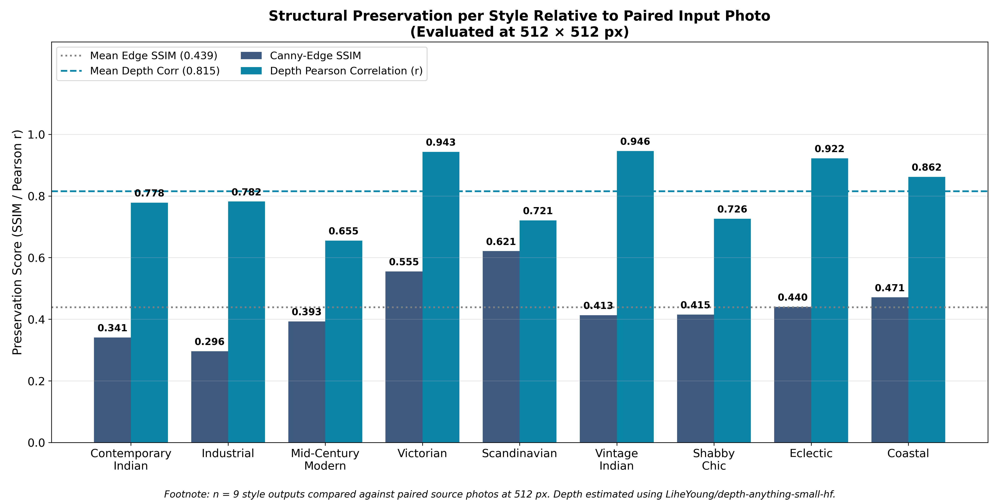
  <br>
  <sub>Per-style edge SSIM and depth correlation (n = 9). From the project report.</sub>
</p>

### Style alignment (zero-shot CLIP, ViT-B/32)

Prompt template: `a {style} style interior room`.

| Result | Value |
|---|---|
| Mean CLIP cosine similarity | **0.294** (min 0.244 Scandinavian, max 0.359 Contemporary Indian) |
| Top-1 style recognised | 6 of 9 (66.7%); approximate 95% Wilson interval 35% to 88% |
| Misclassified | Victorian, Scandinavian and Vintage Indian were all predicted as Contemporary Indian |

CLIP similarity is a relative score that depends on the model and prompt wording; it is **not** a percentage of style accuracy. The 6/9 figure is a top-1 hit rate on nine images, and the wide interval shows it is not a reliable estimate of general performance.

| Similarity matrix | Per-style similarity |
|:---:|:---:|
| 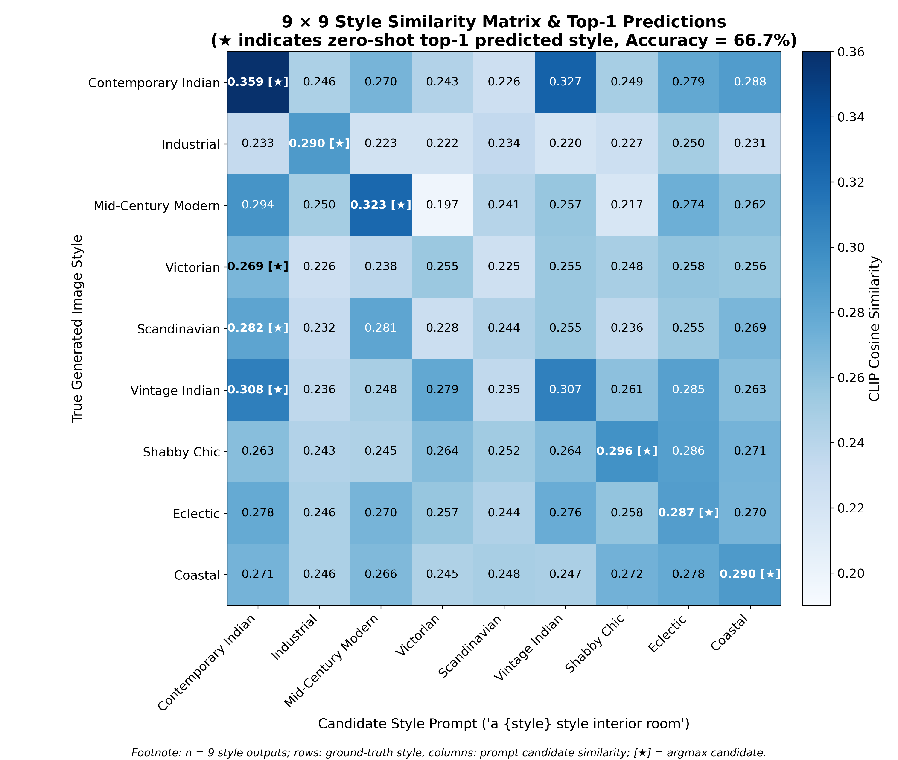 | 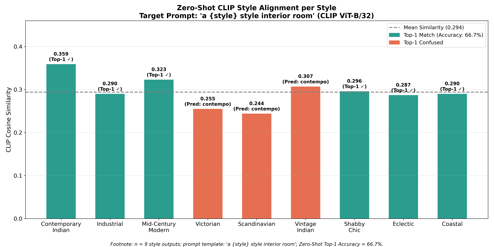 |

### Object detector comparison (experiment)

Across the nine generated outputs, pretrained COCO **YOLOv8m** produced about **66 detections across five categories**, and **YOLO-World v2** about **92 detections across eight categories**.

- These are **detection counts and mean confidences, not accuracy, precision, recall or mAP.** There is no ground-truth annotation in this comparison.
- Neither detector found any beds, doors, ladders or sinks in these outputs.
- YOLO-World v2 is **not** part of the application code; the running service uses YOLOv8 only.

<p align="center">
  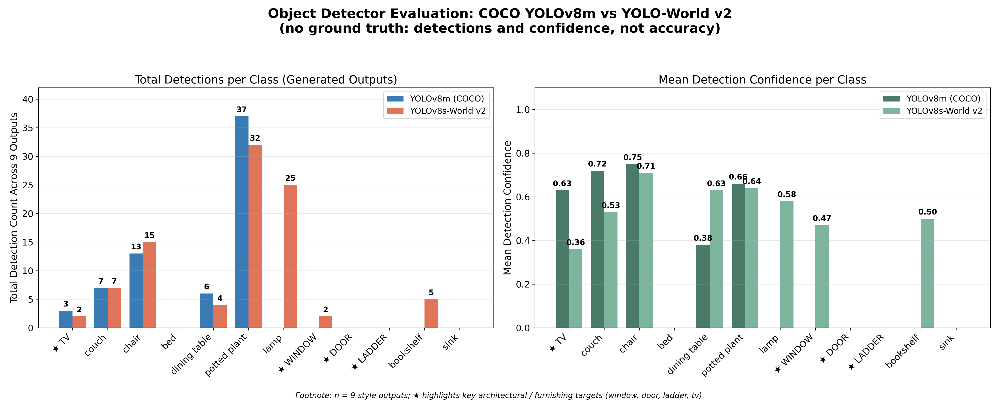
  <br>
  <sub>Detection counts and mean confidence per class across nine outputs (the chart labels the second model "YOLOv8s-World v2"). From the project report.</sub>
</p>

### What is not evaluated

- No controlled comparison of generation **with and without** ControlNet.
- No quantitative evaluation of colour-palette fidelity.
- No ground-truth detection benchmark for the application's detector.
- Samples are small (n = 9), single-run and un-repeated across seeds.

---

## Performance benchmarking

> **Local development measurements.** These cover the **room-analysis** path only. They are not image-generation latency, not production performance, and not a load or scalability test.

### 20-trial room-analysis benchmark

20 measured trials after one excluded warm-up, using one test photograph (`contemporary_indian`, `living_room`). P95 is the 95th percentile: about 95% of trials were at or below it.

| Component | Average | Median | P95 |
|---|---:|---:|---:|
| Room analysis (end to end in the ML service) | 3.952 s | 3.887 s | 4.304 s |
| YOLOv8 inference | 0.443 s | 0.422 s | 0.519 s |
| Dominant-colour extraction | 0.823 s | 0.800 s | 0.975 s |
| Image-processing pipeline | 3.935 s | 3.869 s | 4.286 s |
| Flask API response | 3.953 s | 3.888 s | 4.305 s |

### Separate single Django API measurement

One call to `/api/studio/analyse/` through Django's test client reported **6.686 s** total, including a **6.357 s** Django-to-Flask round trip. This is **one sample**, not an average, median or P95.

### Methodology and limits

- Timing used `time.perf_counter()` in Python and `performance.now()` in the browser, with request IDs, structured timing logs and response timing headers, as described in the benchmark report.
- The results were taken from an execution transcript and were **not recomputed from raw benchmark output**; the exact hardware of the 20-trial run is not recorded. The project report separately describes a Windows 11 machine with an Intel Core i5-10210U and 8 GB RAM.
- The instrumentation and benchmark scripts described in the report (`config/performance.py`, `ml/benchmark_performance.py`, `ml/modules/performance.py`) are **not part of this repository snapshot**, so these figures cannot currently be reproduced from it.
- **Image generation was not benchmarked.** No average, median or P95 generation time is reported, and none should be inferred from the table above. Generation runs on a remote ZeroGPU Space, so queueing, cold starts and quota affect it.

---

## Testing and validation

### Tests in this repository

| Suite | Command | Contents |
|---|---|---|
| Django (`studio`) | `cd house-muse/backend && python manage.py test studio --settings=config.test_settings` | 5 tests for the refine endpoint: unauthenticated rejection, unknown project, refinement without a prior image, successful refinement with history, base64 result handling. Uses in-memory SQLite and mocks the ML service |
| Flask (`ml`) | `cd house-muse/ml && python -m unittest test_refine_api -v` | 5 tests for `/api/refine-image` and `/api/generate-image` with the generator mocked. Requires the ML dependencies to be installed |
| Frontend types | `cd house-muse/frontend && npm run check` | `tsc --noEmit` |
| Frontend build | `cd house-muse/frontend && npm run build` | Vite production build |

`ml/test_hf_space.py` is a manual script for exercising a live Space, not an automated unit test.

### Verification performed while preparing this README

| Check | Result |
|---|---|
| Django `studio` tests (command above, fresh environment) | 5 of 5 passed |
| `npm run check` (TypeScript) | Passed |
| `npm run build` | Passed |
| Flask unit tests | Not re-run in the audit (they need the full ML dependency stack) |

### Development validation reported in the benchmark report

The report records, from a development session: ML compilation and tests (9 passed), Django system check and Studio tests (9 passed), frontend TypeScript and production build passing, Flask health endpoint and frontend returning HTTP 200, and CORS timing-header checks passing. These are reported outcomes, not a clean-checkout run. The current repository snapshot contains 5 Django and 5 Flask tests, so the reported counts of 9 reflect a different test set than the one committed here.

There are no end-to-end browser tests and no tests of the generation path against a live Space.

---

## Engineering decisions and trade-offs

- **Three services instead of a monolith.** The ML stack (PyTorch, Ultralytics, OpenCV) has heavy, fast-moving dependencies and different scaling needs from a CRUD API. Separating it lets Django stay small and lets the ML service be restarted or replaced independently. *Cost:* three processes to run, and an extra network hop (visible in the 6.686 s vs 3.95 s single-sample gap).
- **Django as the only public entry point.** Authentication, ownership checks and persistence live in one place; Flask stays stateless and unauthenticated. *Cost:* Flask must be network-isolated, since it trusts its caller.
- **Remote GPU inference.** SDXL with ControlNet and LoRAs does not fit a laptop-class machine, so generation is hosted on Hugging Face ZeroGPU and called through `gradio_client`. *Cost:* availability, queueing and quota are outside the project's control, and generation latency is variable and unmeasured.
- **Depth ControlNet for geometry guidance.** Conditioning on a Depth-Anything depth map keeps the overall spatial layout while allowing surfaces and furniture to change. *Trade-off:* the evaluation shows layout is retained moderately (depth correlation 0.815) and unevenly across styles, and edges and fine structure change substantially.
- **LoRA adapters for style.** One shared SDXL base with nine pre-loaded adapters switched per request avoids loading nine full models. *Trade-off:* adapter weights are separate artifacts that must be supplied to the Space.
- **Graceful degradation in the CV pipeline.** SAM, CLIP and Places365 are optional; the service falls back to bounding-box crops and, when no room type is supplied, to object-based room inference. *Trade-off:* behaviour and output quality depend on which optional packages are installed.
- **Layered generation fallbacks.** If the Space is unavailable, the service still returns an image from a text-to-image provider. *Trade-off:* that image ignores the uploaded room's structure, so the fallback keeps the app responsive but changes what the user receives.
- **Catalogue in relational tables.** A 378-row catalogue is loaded into PostgreSQL and summed with the ORM for the budget breakdown. A relational table fits this size; nothing heavier is needed.
- **Explicit ML error mapping.** Django wraps ML-service failures in `MLServiceError` and returns 502 with a message, with a 60-second timeout, rather than surfacing raw exceptions.

---

## Limitations

**Implementation**

- Run and validated in local development only. There is no deployment configuration, no production hardening, no monitoring.
- Generation depends on an external Hugging Face Space and on LoRA weights that are not distributed with the repository. Without them, the app uses text-to-image fallbacks that do not preserve room structure.
- The access token is stored in `localStorage`, which is convenient but exposed to any cross-site scripting flaw.
- The Flask service has no authentication, allows local-development CORS origins (including `null`), and runs with `debug=True` in its entry point; it is not suitable for exposure as-is.
- Image bytes between services are passed as base64 in JSON in places, which is simple but inflates payloads.
- The benchmark and instrumentation tooling is not in this repository.
- Test coverage is narrow: refine and generate endpoints are covered; analysis, authentication, catalogue and the frontend are not.

**Evaluation**

- All generation metrics come from nine images, one per style, with different source photos across styles and no repeated seeds. They are preliminary.
- CLIP similarity is auxiliary and cannot separate all nine styles (three styles were predicted as Contemporary Indian).
- Detector comparison reports counts and confidence only; there is no ground truth, so nothing here establishes detection accuracy.
- No baseline-versus-ControlNet experiment, and no human or user study.
- Latency figures cover room analysis only; generation latency, concurrency and reliability are unmeasured.

---

## Future improvements

*Planned or suggested work, not current features.*

- Run a controlled baseline-versus-ControlNet experiment (same photo, prompt, seed) to quantify geometry preservation, and add mask-aware or segmentation-aware conditioning to hold walls, windows and doors more firmly.
- Evaluate the object detector on a labelled interior set (precision, recall, mAP) and publish the fine-tuned weights and training configuration.
- Replace the single-sample, nine-image evaluation with a larger, multi-seed set and add perceptual metrics alongside SSIM, depth correlation and CLIP.
- Benchmark generation separately (queue time, generation time, download time, failures) and commit the benchmark harness with raw outputs, hardware details and the exact commit.
- Add integration tests across Django and Flask, authentication and catalogue tests, and browser-level end-to-end tests.
- Move the token to an `HttpOnly` cookie or add short-lived access tokens, add rate limiting, and authenticate service-to-service calls.
- Containerize the three services, add a production WSGI/ASGI setup and configuration, and add monitoring and structured logging.
- Make generation asynchronous with a job queue and status polling instead of a single long request.
- Pin and document the full ML dependency set, including optional SAM, CLIP and Places365.

---

## Contributing

There is no formal contribution process. Issues and pull requests are welcome; for non-trivial changes, please open an issue first to discuss the approach. Please do not include credentials, `.env` files or model weights in a pull request.

---

## License

No license file is currently included in this repository, so all rights are reserved by default and the code is not licensed for reuse.

---

## Project information

| | |
|---|---|
| **Project** | House Muse: AI-Based Interior Design and Room Redesign Platform |
| **Repository** | [github.com/ArnavGit17/House-Muse](https://github.com/ArnavGit17/House-Muse) |
| **Domains** | Computer vision, generative AI, full-stack web development, REST API design |
| **Stack** | React, TypeScript, Vite, Tailwind CSS, Django REST Framework, Knox, Flask, PostgreSQL, OpenCV, Ultralytics YOLOv8, scikit-learn, SDXL, ControlNet, LoRA, Hugging Face Spaces |
| **Context** | Team academic project, Department of Electronics & Computer Science, Vidyalankar Institute of Technology (University of Mumbai), 2025–26 |
